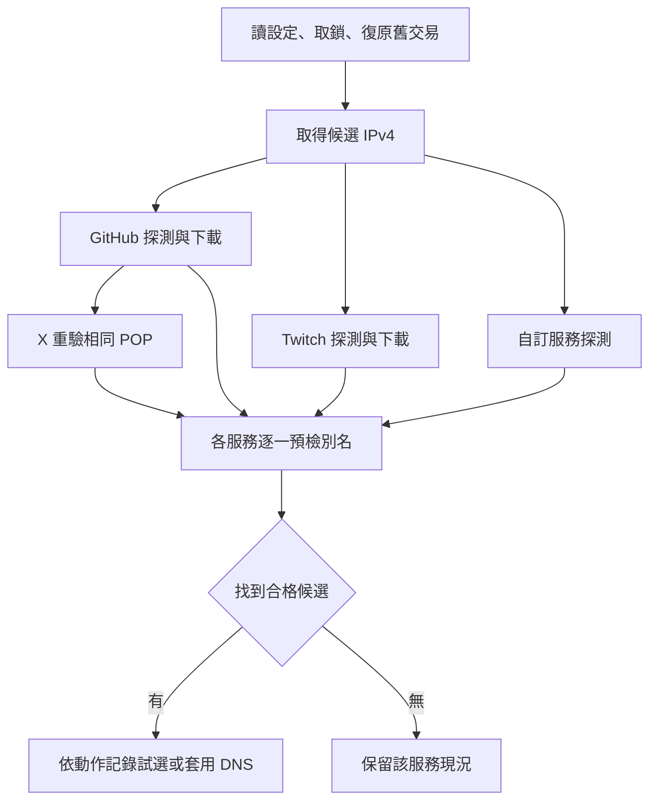

# 架構與資料流

路由器負責探測、評分與改動自己管理的 DNS。Python 僅用於開發機建置、靜態檢查和測試。一次執行按服務處理，同一次選路可能出現 GitHub 已套用、Twitch 保留舊紀錄、X 探測失敗等不同結果。

圖中分支代表服務依賴；服務本身依序處理，同一服務的候選探測才以背景工作並行。

| 模組 | 主要責任 |
|---|---|
| `config`、`core` | 服務定義、預設政策、字串／網段／POP 處理、排名 |
| `storage` | 設定與服務、分頁快取、JSON 主副本及狀態檔命名 |
| `network`、`benchmarks` | 以原主機名稱驗證 TLS、指定 IPv4，讀取 HTTP 標頭、TCP Netwatch 延遲、取得真實下載資源及執行取樣 |
| `discovery` | Fastly 網段、每個 /24 的候選尾碼、實際 DNS 補充候選、重新驗證及下載短名單 |
| `dns` | 逐別名預檢、衝突檢查、暫存新 A、替換受管理紀錄、復原中斷交易 |
| `engine`、`commands` | 服務順序、X 借用 GitHub、健康檢查、設定與排程命令、互斥鎖 |
| `selftest` | 執行於 RouterOS 的本地自我測試，含查詢、資料型別及既有狀態檔讀寫 |

## 探測與評分

從 Fastly 清單取 IPv4 網段；取得清單失敗時使用內建快照。完整探索會檢查網段範圍，以服務尾碼組出每個 /24 的位址，另補上由服務目前 DNS A 換算的候選。通過 HTTPS、HTTP 與主要 POP 條件後再量連線時間。Netwatch 提供可辨識的 TCP 時間時用 TCP，否則明確記為 HEAD 整體請求時間。快取中的舊候選下次仍需重驗。

GitHub 查詢 Release API、取得資產及短效網址。Twitch 從首頁選取 JS 資源。小檔可完整下載，大檔先檢查 Range 支援。測量涵蓋整個 Fetch 呼叫；下載資料丟棄，部分中繼資料會先寫入暫存檔。一次服務內以峰值的 30% 與 3 Mbps 的較大者計算順暢次數，再看中位近似速率、連線用時與 IP。穩定性相當且新候選至多快 20% 時，可保留目前選點。X 以同一個 /24 的 .159 獨立探測，需與 GitHub 候選的觀察 POP 相同。

## 寫入、保留與復原

狀態放在 `flash/fhr-state`（有 flash 目錄時）或 `fhr-state`。單一 JSON 最多 57,000 位元組，掃描快取每 150 筆分頁。寫入先用 `.new` 回讀驗證，再將前版轉成 `.prev`。JSON 無效時可試讀有效副本；狀態存在但因權限讀不到時會停止。被讀回的備份值可供程式使用，這並非就地修好毀損的主檔。

一般只處理完整名稱、類型 A、註解前綴 `FHR:auto:` 的紀錄。預設也可接管有已知舊版標記的 A，將其寫入初始快照。寫入前先檢查同名外來紀錄及匹配的正規表示式，再保存舊 DNS、目前與前一選點。新紀錄先停用，切換並驗證後才刪舊紀錄。失敗時依交易資料回復；進入下一次公共命令時也會檢查中斷的交易。這些檢查有明確範圍，複雜的父網域轉送與外部解析器仍需實測。

在各服務切換或還原時，程式會清除 RouterOS DNS 快取。沒有跨服務的單一交易。檔案鎖用來避開重疊執行，超過四小時或依開機時間判定過期才可能清除。遇到 `FHR BUSY` 請先檢查仍在跑的 job 與帶 `FHR:temporary-tcp` 註解的 Netwatch。儲存裝置斷電期間的原子性尚未證實。

## 主要設定與預設值

| 參數 | 預設 | 意義 |
|---|---|---|
| `parallel`、`rounds`、`shortlist` | 8、3、10 | 並行探測數（1–32）、測速輪數（1–9）、每服務測速候選（1–64） |
| `sampleBytes`、`sampleSeconds`、`probeSeconds` | 8 MiB、20 秒、6 秒 | 取樣目標、取樣請求時間上限、主要探測時間上限 |
| `cacheSeconds`、`cacheStaleSeconds` | 86,400、604,800 秒 | 一般快取效期與指定快取切換能用的最長時間 |
| `excluded`、`region` | `\|SIN\|QPG\|`、空字串 | 排除代碼與指定 POP |
| `smoothPercent`、`smoothFloorBps`、`stickyPercent` | 30、3,000,000、20 | 順暢門檻與保留目前選點的容差 |
| `nearMarginMs`、`latencyProbe` | 60、`tcp` | 附近候選的時間範圍及連線時間量法 |
| `dnsTTL`、`sourceAddress`、`vrf`、`resolver` | `5m`、`0.0.0.0`、空、空 | A 的 TTL、Fetch 來源位址、既有 VRF、名稱解析時可指定的解析器。命名路由表和 VRF 的用途不同 |
| `healthFailures`、`healthFailOpen` | 3、true | 健康檢查失敗門檻與無可用舊選點時是否恢復原本 DNS |
| `allowLatencyFallback`、`adoptLegacy`、`verbose` | true、true、false | 無測速資源時是否容許按連線時間選點、是否接管舊標記 A、詳細輸出 |

完整預設值與設定驗證見 [config](../routeros/FHR-config.rsc) 及 [commands](../routeros/FHR-commands.rsc)。新建排程的預設是每六小時 apply、每十五分鐘 health、開機後延遲三十秒執行 health。舊排程啟用時會核對擁有者、更新權限；已存在項目的自訂時間或 on-event 並非一律重建。腳本與排程權限是 `ftp,read,write,policy,test,sensitive`，腳本保留 `dont-require-permissions=no`。
